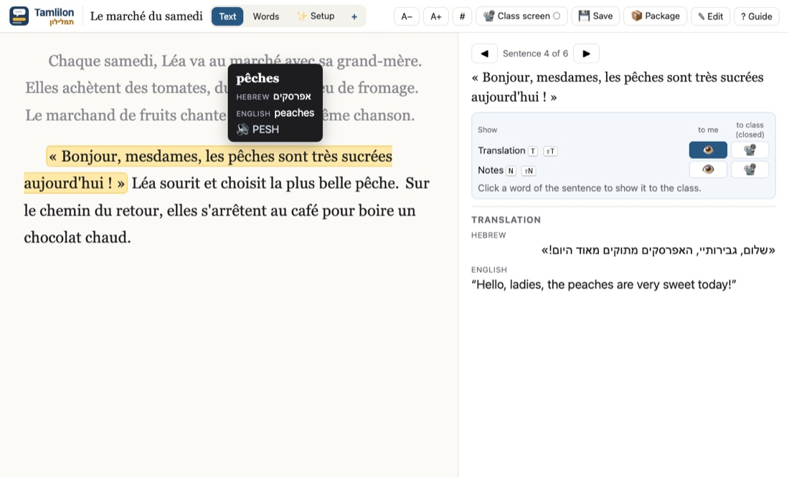

<p align="center">
  <picture>
    <source media="(prefers-color-scheme: dark)" srcset="assets/tamlilon-logo-dark.svg">
    
  </picture>
</p>

<p align="center"><b>Any text becomes a reading lesson.</b><br>
Paste a text in any foreign language: every word gets a pop-up translation, every sentence a translation you reveal
when you want, and the class can follow on a projector. Free, one file, works without internet.</p>

<p align="center"><a href="https://dinmo.github.io/Tamlilon/"><b>▶ Open Tamlilon</b></a> &nbsp;·&nbsp;
<a href="https://dinmo.github.io/Tamlilon/"><b>⬇ Download it</b></a> &nbsp;·&nbsp;
<a href="https://dinmo.github.io/Tamlilon/#he" dir="rtl" lang="he">בעברית</a></p>

## Start in 3 steps

1. **Open it.** Go to **[dinmo.github.io/Tamlilon](https://dinmo.github.io/Tamlilon/)** and click the big blue button
   **Open Tamlilon** to use it online.
   **To keep it on your computer,** click **Download** there instead: one file, `tamlilon.html`, goes to your Downloads
   folder (move it to your Desktop if you like). Double-click it: Tamlilon opens in your web browser, even without internet.
2. **Paste your text, then let a free AI translate it.** Paste your text in the big box. Click **📋 Copy the next prompt**,
   paste it into a free AI chat ([chatgpt.com](https://chatgpt.com) or [gemini.google.com](https://gemini.google.com))
   and send. Copy its answer and paste it back into Tamlilon.
3. **Save, and teach.** Click **💾 Save**: your lesson becomes one file. Double-click it any time to open it again.
   Rest the mouse on a word to see its meaning.

<p align="center"></p>

Works on a computer (Windows, Mac or Linux) in Chrome, Edge, Safari or Firefox; not on phones or tablets.
The downloaded file needs no internet and no installation: only the translation step uses a free AI chat online.
Your texts stay on your computer: Tamlilon sends nothing anywhere (only what you paste into the AI chat yourself goes there).

---

# The full guide

The same guide is inside the tool: click **? Guide** (top right).

## A. Make a lesson (once per text)

1. **Open the tool.** Double-click `tamlilon.html`. It opens in your web browser, on the **✨ Setup** tab.
2. **Step 1: name and languages.** Type a title, the language of the text (e.g. *French*), and the language(s) to
   translate into (e.g. *Hebrew* and *English*; the second one is optional). Under *Pronunciation of words*, tick the
   alphabets you want the pronunciation in: English letters, Hebrew letters, both, or **None**.
   (If you tick another alphabet later, 📋 in step 3 asks the AI for it.)
3. **Step 2: the text.**
   1. Copy your text (from a web page, a PDF, an e-mail, or type it).
   2. Click in the big box and paste: <kbd>Cmd</kbd>+<kbd>V</kbd> on a Mac, <kbd>Ctrl</kbd>+<kbd>V</kbd> on Windows.
   3. The tool cuts it into sentences: **one sentence per line**, an **empty line** between paragraphs.
      (Pasting over the whole box cuts the new text too. If you paste more text next to lines already there,
      click **✂ Cut into sentences again**.)
   4. Read the lines. If a line holds two sentences, click between them and press <kbd>Enter</kbd>.
      If one sentence is cut in two lines, delete the line break. (Check dialogue with « … » or quotes, and words cut
      at the end of a line in a PDF, most carefully.)
   5. Click **✓ Use this text**.
4. **Step 3: translations, with the free AI chat.** One round is usually enough:
   1. Click **📋 Copy the next prompt**.
   2. Open the AI chat in another browser tab. Click in its message box, paste, and send.
   3. Wait until the answer is finished: its last line is `END`.
   4. Copy the answer with the AI's copy button: at the top right of the grey box (two small squares, or the word *Copy*),
      or under the answer.
   5. Come back to the lesson tab, click in the box *Paste the AI's answer here*, and paste. Both bars fill up at once.

   For a long text the AI may stop before the end. Then click 📋 again: the new prompt asks only for what is still missing.
   A translation you corrected by hand is never replaced by a later answer.
   Tested with ChatGPT and Gemini (free).
5. **Save.** Click **💾 Save** (top right). The lesson becomes **one file** (e.g. `Three riddles.html`): Safari and
   Firefox put it in your **Downloads** folder; Chrome and Edge ask where to put it. Move or rename it as you like. **To open it again, double-click that file.**

## B. Teach with it

- **Text** tab: the current sentence is highlighted in yellow.
  Next sentence: <kbd>→</kbd> or <kbd>Space</kbd>. Previous: <kbd>←</kbd>. Or click any sentence.
- **Rest the mouse on a word**: its translation and pronunciation appear.
- The side panel has a **Show** box. For the translation and the notes:
  - 👁 = show it **to you** (keys <kbd>T</kbd>, <kbd>N</kbd>),
  - 📽 = show it **to the class** (keys <kbd>Shift</kbd>+<kbd>T</kbd>, <kbd>Shift</kbd>+<kbd>N</kbd>).
- **A−** / **A+**: text size. **#**: sentence numbers. **Words** tab: every word of the text with its translation.

## C. With a projector (the class sees a clean screen; you keep the answers)

1. Connect the projector. On a Mac: **Apple menu → System Settings → Displays →** choose the projector **→ “Extended display”**
   (not “Mirror”: mirroring would show your notes to the class). On Windows: press the Windows key + <kbd>P</kbd> and
   choose **“Extend”** (not “Duplicate”). On Linux: open the display settings and choose to **join / extend** the displays (not “Mirror”).
2. Click **📽 Class screen**. A second window opens. If nothing opens, the browser blocked it: allow pop-ups for this file and click again.
3. Drag that window onto the projector and click its **⛶ Full screen** button (top right corner).
4. The dot next to 📽 turns **green** when the two windows are linked. Teach from your own window.
   - Click a word of the current sentence: the class sees it highlighted, with its meaning. Click it again to hide it.
   - <kbd>Esc</kbd> clears the class screen. Going to the next sentence also starts clean.
   - To change the size of the class screen's text, click on its window, then press <kbd>+</kbd> or <kbd>−</kbd>.
     <kbd>F</kbd> there switches full screen on and off.

## D. Change things (✎ Edit)

Click **✎ Edit** (top right). Yellow ✎ buttons appear everywhere. Click **✓ Done editing** when finished.

| To change… | Do this |
|---|---|
| a word's pop-up | click the word, change it, **Save** |
| a sentence's translation | **✎ edit** next to *Translation* |
| a sentence | **✎ Edit this sentence**: fix it, press <kbd>Enter</kbd> to cut it in two, **Join with the next sentence**, or tick *starts a new paragraph* |
| the notes | **✎ add / edit notes** (see below) |
| the title | the **✎** next to it |
| the tabs | **+** adds a tab; drag a tab to move it; double-click a tab to rename it; **×** removes one of your tabs |

**Notes, without any formatting knowledge:** in **✎ add / edit notes**, click a kind of note:
💬 Expression · 📘 Grammar · 🌱 Word origin · ❓ Question for the class · 🌍 Culture / context · ✏️ Other.
A ready-made sentence appears (for example `**…** means …`): replace each `…` with your own words.
Click a word of the sentence (the buttons under *Words of the sentence*) to put it in the note, in bold.
**B** and *I* make the selected text bold or italic. Arrows ↑ reorder notes; 🗑 removes one.

**Your own tabs** (author, exercises, vocabulary…): each tab has sections. A section has a title, a text, and optionally a
translation and an answer, both hidden behind a button until you click it. Word pop-ups work there too.

## E. Keep and share

- Every change is kept **in this browser** at once, so nothing is lost if you close the window.
  **💾 Save** puts it **in the file**; the button turns orange (💾 Save •) when there is something new to save.
  - Safari and Firefox save a new file each time (`name.html`, `name (1).html`, …): the newest one is the one to keep.
  - Chrome and Edge show a Save window the first time you save after opening the lesson: choose the lesson's own file
    and click **Replace**. After that, Save updates it without asking.
- If you open an older copy of a lesson while this browser has newer changes, a yellow bar tells you and offers both versions.
- If you open the empty tool after working on a lesson, a yellow bar offers to continue it (or to start a new one).
- **📦 Package**: a **read-only** copy in one file, to send by e-mail, WhatsApp or USB. It opens by double-click on any
  computer, the class screen works, but it cannot be edited. It does not contain the archive (removed sentences and tabs).
- **A new text?** Open the empty `tamlilon.html` again. Keep this empty file as your “master copy”.

## Keys

| Key | Does |
|---|---|
| <kbd>→</kbd> <kbd>Space</kbd> / <kbd>←</kbd> | next / previous sentence |
| <kbd>↓</kbd> <kbd>PageDown</kbd> / <kbd>↑</kbd> <kbd>PageUp</kbd> | next / previous (a presentation clicker works too) |
| <kbd>Home</kbd> / <kbd>End</kbd> | first / last sentence |
| <kbd>T</kbd> / <kbd>N</kbd> | translation / notes, on your screen |
| <kbd>Shift</kbd>+<kbd>T</kbd> / <kbd>Shift</kbd>+<kbd>N</kbd> | translation / notes, on the class screen |
| <kbd>Esc</kbd> | clear the class screen |
| <kbd>+</kbd> <kbd>−</kbd> | text size. For the class screen: click its window first, then press + or − |
| <kbd>#</kbd> | sentence numbers |
| <kbd>1</kbd>…<kbd>9</kbd> | open tab 1…9 |
| <kbd>E</kbd> | edit mode |
| <kbd>?</kbd> | the guide |
| <kbd>F</kbd> | full screen (on the class screen) |

The letter keys also work with a Hebrew keyboard (the key where T is, and so on).

## If something goes wrong

| Problem | What to do |
|---|---|
| The AI added explanations, a table, bold text, or put everything in one long paragraph | Paste it anyway; the tool skips what it doesn't need. If nothing is added, tell the AI: *“Please answer only with the lines in the format I asked.”* |
| The answer stops in the middle | No problem: paste what you got, then click 📋 again: the new prompt asks only for what is missing. If it happens often: *More options → Sentences per prompt* → choose fewer. |
| “This is the prompt, not the AI's answer” | You pasted the prompt back. Copy the AI's answer instead. |
| “I found no translations” | The AI did not answer with S / W lines. Tell it: *“Please answer only with the lines in the format I asked.”*, then copy its new answer. |
| A word has no pop-up | ✎ Edit, click the word, type its meaning. Or run another round of step 3. |
| The class screen does not open | Allow pop-ups for this file in the browser, then click 📽 again. |
| The dot next to 📽 stays grey (○) | Close the class window and click 📽 again. |
| The file opens as text, or on a phone it does nothing | Open it on a computer, with a web browser (right-click → Open With → Safari / Firefox / Chrome). |

---

## The prompt (for reference)

The tool writes the prompt for you, with your sentences and words inside. This is its shape, so you can see what the AI is
asked and, if you like, adapt it:

```
I am preparing a reading lesson in French for students who speak Hebrew and English.
Please translate the sentences and the words listed below.

Reply ONLY with lines in this exact format, and nothing else (no introduction, no headings, no tables, no bold, no comments). Put all the lines inside ONE code block, one item per line:

S<number> | <Hebrew translation> | <English translation>
W | <the word, copied exactly> | <Hebrew meaning> | <English meaning> | <pronunciation in English letters> | <pronunciation in Hebrew letters>

Rules:
- Write one S line for each sentence, with its number. Translate the whole sentence, naturally and faithfully.
- Write one W line for each word, copying the word exactly as it is in the list. Give the meaning it has in these
  sentences, in 1 to 4 words. If it is an inflected form (a conjugated verb, a plural, a feminine form...), add its
  dictionary form in brackets.
- Pronunciation: how to say the French word, written in English letters, then written in Hebrew letters. In Latin letters,
  write the stressed syllable in CAPITALS.
- Use the | character only as a separator.
- After the last line, write a line with only the word END.

SENTENCES (5):
S1 = …
…
WORDS (33):
…
```

The answer is plain text, one line per item, for example `S1 | <translation> | <translation>` and
`W | fille | <meaning> | <meaning> | FEE-yuh | <in Hebrew letters>` (one pronunciation per ticked alphabet). You can also write such lines yourself and paste them in the same box.

## How it works (for the curious)

- **One file is the whole thing.** `tamlilon.html` contains the program; a saved lesson is the same program with the
  lesson written inside it (in a block of data near the end). That is why a lesson opens by double-click, offline, on any computer.
- **Why paste instead of text files in a folder?** A page opened by double-click is not allowed by the browser to read other
  files next to it (a security rule in all browsers). Pasting the AI's answer into the page avoids that, and is simpler.
- **The tool does the exact work, the AI only translates.** The tool cuts the text into sentences, lists the words, numbers
  everything, writes the prompt, checks what came back and asks again only for what is missing. So the original text is never
  changed by the AI, and a cut-off or messy answer costs nothing.
- **Translations by AI are drafts.** Check them, especially single-word meanings (a word gets one meaning for the whole text)
  and pronunciations.
- The class screen uses the same method as presenter views (a second window driven from the first with `postMessage`),
  which works from a double-clicked file.
- Left out on purpose (they need a full AI pass): key words per sentence, verbs and tenses, conjugation tables.

---

## Credits and licence

**Tamlilon** · <span dir="rtl" lang="he">תמלילון</span> — Created by **Dinmo** · a **Yours Truly** project.

© 2026 Dinmo (Yours Truly). Tamlilon is free software: you can use it, share it and change it under the terms of the
[GNU General Public License, version 3](LICENSE) (GPL-3.0).
